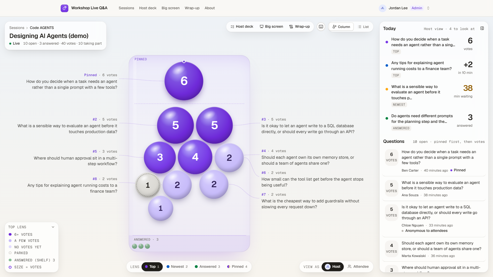

# Workshop Live Q&A

A live question board for training sessions. Attendees join with a short code (or by scanning a QR code), post
questions, optionally anonymously, and upvote each other's. The facilitator sees the top unanswered questions, marks
them answered, parks, pins, hides or rewords them, and projects a clean big-screen view with the join code and QR code.
When the session ends, the wrap-up lists what was answered and what was not, ready to copy as Markdown. Built for
virtual cohorts of 15 to 20 people; works for any session. A Microsoft Fabric App (Rayfin 2.0).



## What it looks like

**Rising questions.** Each question is a bubble in a glass column: votes inflate it and push it up past the others,
pinned questions dock at the top, and answered ones pop softly onto the shelf at the bottom. Labels beside the column
carry the text of the leading questions, and the column settles as soon as nothing changes (a small spring
simulation, no 3D library).

- **Lenses** (keys 1–4): **Top** (size and depth of colour by votes), **Newest** (the freshest rise; colour by age),
  **Answered** (answered questions fill the column, the open ones wait on the shelf), **Pinned** (pinned and parked
  lit, the rest dimmed). **View as** host or attendee (V) shows exactly what the room sees.
- **Today** ranks the most wanted question, the fastest rising one, the one waiting longest (host) or your own
  question's place (attendee), the newest and the latest answer; each item focuses its bubble.
- **Tools:** **Big screen** (projector view: the top five in huge type re-ordering as votes arrive, a rising strip of
  every open question, the join code and QR), **Host deck** (a keyboard-first moderation queue with a spotlight and a
  `?` cheat sheet), **Wrap-up** (a snapshot of the column, the answered and unanswered lists, Markdown to copy).
- **Fallbacks:** the List view (L) is the same data as an accessible table; with reduced motion the column is placed
  without animation; nothing needs WebGL (`?nowebgl` renders the same column). Phones get the column, then the ask box
  and a thumb-sized upvote list, with Today in a bottom sheet.

Screenshots of every screen, light and dark, desktop and phone: [docs/redesign/](docs/redesign/).

Demo video (about 2 minutes, AI-generated narration, captions burned in): [demo/out/workshop-live-qa.mp4](demo/out/workshop-live-qa.mp4) · captions file [demo/out/workshop-live-qa.srt](demo/out/workshop-live-qa.srt). Re-record with `npx tsx tools/demo/record.ts workshop-live-qa` from the repo root.

## 1. Prerequisites

- A Microsoft Fabric tenant with the **Fabric Apps** workload enabled.
- A workspace on a Fabric capacity, and **Edit** permission (Contributor or higher) on it to deploy.
- Node.js 20 or later (the monorepo is tested on Node 24).
- **Audience:** deployed apps accept Fabric sign-in (Microsoft Entra ID) only, and every attendee needs access to the
  app item. Workspace members get it by default. For attendees outside your organisation, invite them as **guest users**
  in Entra ID first, then add them (or a group they are in) to the workspace or share the app item with them. Plan this
  before the session; there is no anonymous join.
- No other tenant settings are needed (the app does not use semantic model connectors or anonymous data access).

## 2. Run locally

```bash
npm install            # once, at the repo root
cd apps/workshop-live-qa
npm run dev            # offline demo on http://localhost:5206 with seed data and a persona switcher
npm run dev:fabric     # rayfin dev: the app against a Fabric backend
```

Demo mode keeps data in this browser's local storage and shows a banner. Switch persona from the identity menu (top
right) or open the app with `?as=<sub>`:

| Persona | Sub | Shows |
| --- | --- | --- |
| Jordan Lee (Host, admin, default) | `demo-host` | Your sessions, the board as host, host deck, big screen, wrap-up |
| Ana Souza | `demo-ana` | Named questions, upvotes |
| Ben Carter | `demo-ben` | Starts with 4 unanswered questions: the 5th is accepted, the 6th refused |
| Chloe Nguyen | `demo-chloe` | Anonymous questions (named in the host deck only) |

Two tabs of the same browser share the demo data, so you can watch a question asked in one tab reach the host deck
in the other within 5 seconds. Join code of the seeded live session: `AGENTS`; closed session: `LAKE25`.

Checks: `npx tsc -b`, `npx vitest run`, `npx vite build --mode demo`, `npx playwright test`. Screenshots for review:
`npx playwright test -c playwright.shots.config.ts` (writes `docs/redesign/`).

## 3. Deploy

```bash
cd apps/workshop-live-qa
npx rayfin login
npx rayfin up --workspace-id <workspace-id>
```

`rayfin up` builds the app (`npm run build:fabric`), deploys the static site, and applies the schema (it creates the
`QaSessions`, `Questions` and `Upvotes` tables, plus `People` and `AppMarkers`). Run it again after any schema change.
Open the app once after deploying so your `Person` row exists.

## 4. Seed and make yourself a host

```bash
npm run seed:fabric -- --admin-email you@yourorg.com
# same as: node tools/seed-fabric.mjs --app workshop-live-qa --admin-email you@yourorg.com   (from the repo root)
```

Inserts the demo data once (skipped if the `seed:v1` marker exists): two sessions — "Designing AI Agents (demo)"
(open, code `AGENTS`, 14 questions across every status, including anonymous ones, and 40 upvotes) and "Lakehouse
Modelling Basics (demo)" (closed a week ago, 7 questions, a finished Q&A) — with fictional attendee names. It also sets
`isAdmin` on your Person row.

With `--admin-email`, the first persona's rows (the seeded host, Jordan Lee in demo mode) are mapped to you, the real
admin: you host both seeded sessions, so they appear under "Your sessions" and you can open the `AGENTS` host deck,
big screen and wrap-up straight away (`hostSub` and `hostName` on the sessions and their questions are yours). The other
personas and attendees stay fictional rows, so their questions and votes show up but nobody signs in as them. Hosts
are admins: only admins see "My sessions" and can create sessions. To make another person a host (they must open the
app once first), run in the Fabric SQL editor:

```sql
UPDATE dbo.People SET isAdmin = 1 WHERE email = 'colleague@yourorg.com';
```

## 5. How it works

| Entity | Fields | Notes |
| --- | --- | --- |
| `QaSession` | title (3–100), code (6 letters/digits, unique), hostSub, hostName, status (`open`/`closed`), allowAnonymous, createdAt, closedAt? | Join codes avoid 0/O and 1/I. |
| `Question` | sessionId, text (3–280), authorSub, authorName, isAnonymous, isPinned, status (`new`/`answered`/`parked`/`hidden`), hostSub, createdAt, answeredAt? | `hostSub` is denormalised from the session for row policies. |
| `Upvote` | questionId, sessionId, voterSub, createdAt | One per person per question; the score is counted on read. |
| `Person`, `AppMarker` | shared | Identity (isAdmin set by SQL) and the seed marker. |

Rules (thresholds live in `src/config.ts`):

1. Join by code, by link (`<app>#/join?code=ABC123`) or with `?code=ABC123` in the normal query string. Unknown and
   closed codes get a friendly message; closed sessions link to their wrap-up.
2. An attendee may have up to **5** unanswered (new or parked) questions per session. The ask box shows the count and
   disables itself at the limit, and `askQuestion` re-counts the attendee's rows by query just before inserting.
3. An upvote is a toggle; the score is the number of distinct voters, computed on read (no stored counter). A double
   click or a duplicate row never counts twice. You cannot upvote your own question; hosts do not vote.
4. Anonymous questions read "Anonymous" for other attendees, on the big screen and in the Markdown export; the author
   sees "Anonymous (you)"; the host deck shows the real name with an "Anonymous to attendees" chip.
5. Attendee order: pinned first, then score descending, then oldest first. Answered questions collapse into their own
   list. The host deck has Open, Answered and Hidden tabs.
6. The host can mark answered, park, reopen, pin/unpin, hide/unhide, edit the text and close the session. Hidden
   questions disappear for attendees (an upvote on a question hidden meanwhile is refused with a message). A closed
   session is read-only. Attendees "edit" by withdrawing their question: its text returns to the ask box.
7. Live screens (attendee board, host deck, big screen) poll every 5 seconds. New questions wait behind an
   "N new questions" pill instead of reordering the list under the reader. The ask-box draft is component state only.
8. Big screen (`#/s/<code>/screen`) renders without the app shell: no header or controls, very large high-contrast
   type, the top 5 unanswered questions with scores, the join code and a QR code of the join link generated in the
   browser (`qrcode`). Escape returns to the console.

### Security model

All data access goes through `DataStore` in `src/domain/`, which re-checks every rule in both demo and Fabric mode.
Row policies (`rayfin/data/*.ts`) close what the policy DSL can express:

| Entity | Read | Create | Update | Delete |
| --- | --- | --- | --- | --- |
| QaSession | signed-in | `claims.sub == hostSub` and status `open`; `closedAt` excluded | `claims.sub == hostSub`; `hostSub`, `code`, `createdAt` excluded | `claims.sub == hostSub` |
| Question | signed-in | `claims.sub == authorSub` and `claims.sub != hostSub`, status `new`, not pinned; `answeredAt` excluded | `claims.sub == hostSub`; `sessionId`, `authorSub`, `authorName`, `isAnonymous`, `hostSub`, `createdAt` excluded | `claims.sub == authorSub` or `claims.sub == hostSub` |
| Upvote | signed-in | `claims.sub == voterSub` | none | `claims.sub == voterSub` |
| Person | signed-in | own row, `isAdmin` excluded | own row, `isAdmin` and `sub` excluded | none |

So nobody but the host of a question's session can change its status, pin it or reword it; attendees can only create
questions as themselves and delete their own; nobody can vote as someone else. The `claims.sub != hostSub` check on
create stops an attendee from naming themselves the "host" of their own question to moderate it.

## 6. VERIFY outcomes and known limits

- **Host-only updates (spec rule 7): expressible.** The policy DSL supports `eq`/`neq` with `and`/`or` and per-action
  `include`/`exclude`, so host-only status changes are a row policy on the denormalised `Question.hostSub`; no Function
  needed. Attendees do not update questions at all (an author-update rule would share the role's single update
  permission with the host's, and would let authors change status); they withdraw and re-ask instead.
- **Create policies with literal checks deploy.** `item.status.eq('new')`, `item.isPinned.eq(false)` and
  `item.status.eq('open')`, together with every other policy above, were accepted when the schema was deployed to
  Fabric on 20 Nov 2026.
- **Who may host** (Person.isAdmin) is enforced in the domain only: there is no admin claim. A signed-in non-admin
  could create a session through the GraphQL API; it would be theirs alone.
- **`hostSub` on a question is supplied by the client.** The create policy stops self-hosting, but cannot check that
  it matches the session's host (no joins in policies). An attendee could insert a question through the GraphQL API
  with `hostSub` set to anything else (say `"x"`); the real host could then neither update nor delete that row. The app
  always copies `hostSub` from the session, and every screen (board, host deck, big screen, wrap-up, session counts)
  drops questions whose `hostSub` is not the session's host, along with their votes. The residual: such a row still
  exists in the database (readable through the API, and it counts towards its author's 5-question limit) until someone
  removes it with SQL.
- **Authors can delete their own answered questions through the API.** The delete policy (`claims.sub == authorSub`
  or host) cannot look at status, so "answered questions stay on the record" is enforced only by `withdrawQuestion` in
  the domain and the UI.
- **The 5-question limit and "a closed session is read-only"** are domain rules (UI plus a re-check before insert).
  A direct API caller could exceed the limit or post to a closed session.
- **Hidden questions are readable through the API** by any signed-in user; only the app hides them from attendees.
- **Anonymous questions still store the author's sub and name** in the database and are readable through the API.
  The host sees names by design; anonymity is towards the room, not the system. The About page says so.
- **One vote per person per question** has no database constraint (no composite unique keys); scoring de-duplicates by
  voter, so extra rows cannot inflate a score.
- **Withdrawn questions leave other people's votes behind** (only a voter may delete a vote); the board ignores votes on
  missing questions.
- **Live updates poll every 5 s** (no subscriptions in Rayfin 2.0); a question reaches other screens in 5 s or less.
- **Join codes** are unique by a check before insert plus a `unique` column constraint.
- **Unhiding a parked question brings it back as new** (there is no column remembering "parked"); unhiding an answered
  question brings it back answered with its answer time.
- **The Fabric build embeds the Rayfin API URL and the publishable key in the JavaScript bundle**, as every Rayfin app
  does. The API URL contains the tenant and workspace ids. Neither is a secret: the publishable key only identifies the
  app, and every data call still needs a signed-in Fabric user and passes the row policies above. Nothing of the kind
  is committed to this repo (`rayfin up` writes it to ignored env files at build time).

## 7. Later

- Database-level admin enforcement with dynamic auth claims (`udf.authClaims`).
- Hiding author columns from attendees at the API level (needs a second role or a Function that serves the board).
- Reopening a closed session; deleting sessions from the UI.
- Merging duplicate questions with their votes.
- Per-session moderation queue (questions visible only after approval).

## 8. Gallery

- **Title:** 12 Days of Fabric Apps: Day [#] – [Theme]: Workshop Live Q&A
- **Blurb (under 80 words):** Questions rise as the room votes. Every question is a bubble in a glass column: votes
  inflate it and push it up, pinned ones dock at the top, answered ones drop onto the shelf. Attendees scan a QR code,
  ask (anonymously if allowed) and vote with one thumb; the host moderates from a keyboard-first deck, projects the top
  five on a big screen and closes with a Markdown wrap-up. Fabric SQL with row-level security.
- **Tags:** Partner | 12 Days of Fabric Apps, Fabric Apps, Training, Q&A, Live, SQL database
